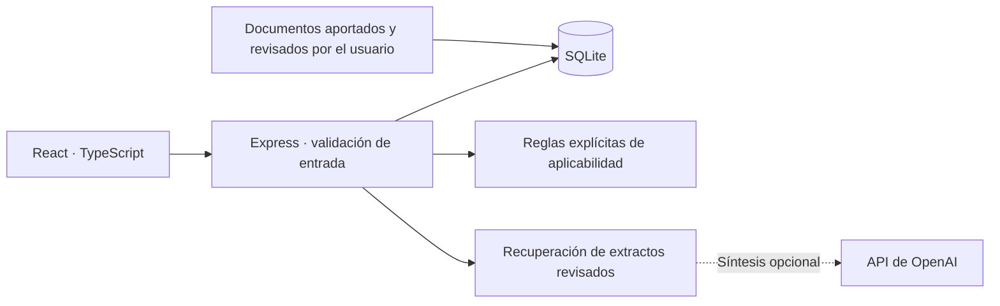

# Arquitectura del piloto

Nexo EHS es una aplicación de una sola organización para desarrollo local. El piloto usa una instalación ficticia de manufactura en Guadalajara. La interfaz y la API comparten el mismo proceso y origen HTTP.

## Componentes

| Ubicación           | Responsabilidad                                                                    |
| ------------------- | ---------------------------------------------------------------------------------- |
| `src/`              | Interfaz React en español, formularios, navegación y vistas imprimibles.           |
| `server/index.ts`   | Inicio del servidor, Vite en desarrollo, archivos compilados y cierre del proceso. |
| `server/app.ts`     | API HTTP, validación y operaciones de dominio.                                     |
| `server/db.ts`      | Esquema SQLite, conexiones y datos de demostración.                                |
| `server/catalog.ts` | Referencias orientativas y reglas de inclusión en la matriz.                       |
| `server/audit.ts`   | Síntesis opcional con el modelo y validación de identificadores de fuente.         |
| `server/*.test.ts`  | Pruebas del comportamiento del backend.                                            |
| `data/`             | Estado local persistente, excluido del repositorio.                                |

En desarrollo, Express monta Vite como middleware. En la ejecución compilada, Express sirve `dist/`. Ambos modos usan la misma API y base de datos. Node 24 aporta `node:sqlite`; npm instala las dependencias bloqueadas en `package-lock.json`.

## Modelo de datos

- `company`: perfil único de empresa, ubicación y actividades declaradas.
- `obligation_progress`: avance, responsable, fecha y evidencia textual, indexados por la referencia del catálogo.
- `workers`: trabajadores y datos necesarios para preparar constancias.
- `trainings` y `training_workers`: cursos y relación de participantes.
- `risks`: proceso, peligro, probabilidad, severidad, controles y campos estructurados de HAZOP.
- `documents`: texto aportado por el usuario, título, jurisdicción, URL, tipo y declaración de revisión.

Las referencias del catálogo son código del servidor, mientras que el avance se conserva en SQLite. Cambiar el diagnóstico recalcula qué referencias se muestran y mantiene el progreso registrado por identificador. La inclusión de una referencia significa que debe revisarse su aplicabilidad; no constituye una determinación jurídica automática.

SQLite tiene claves foráneas activas y utiliza WAL. La relación entre cursos y trabajadores preserva el vínculo de las constancias. La ruta predeterminada de la base es relativa al directorio de ejecución, por lo que los comandos deben iniciarse desde la raíz del checkout o usar `EHS_DB_PATH` explícita.

## Recuperación y evidencia

El consultor selecciona contenido aportado al registro documental. Solo una fuente de tipo oficial y marcada como revisada puede participar como fundamento normativo. Un procedimiento interno puede guardarse, pero no se convierte en legislación.

La recuperación muestra extractos y sus fuentes. Si no encuentra sustento en el corpus disponible, la respuesta debe indicarlo. La aplicación no debe presentar una referencia orientativa del catálogo como si fuera una cita textual verificada, ni inferir artículos que no estén presentes en el documento recuperado.

La búsqueda local puntúa coincidencias de términos en el texto y título de documentos revisados; no usa embeddings ni una base vectorial. Sin credencial, entrega los extractos directamente. Con `EHS_AI_API_KEY`, `server/audit.ts` puede pedir una síntesis a `https://api.openai.com/v1/chat/completions`, usando `EHS_AI_MODEL` o `gpt-4.1-mini`.

El modelo recibe solo la pregunta y la evidencia recuperada, con instrucciones de tratar los documentos como datos y de citar los identificadores aportados. El servidor exige un resultado JSON y rechaza identificadores ajenos al conjunto de evidencia. Un tiempo de espera de 20 segundos, error del proveedor o formato inválido produce una respuesta extractiva con aviso. La validación de identificadores no prueba que cada afirmación esté sustentada; falta una evaluación de fidelidad semántica antes de cualquier uso jurídico.

La IA requiere una credencial y autorización de red para el destino del proveedor. Su habilitación implica transmitir preguntas y extractos a ese servicio. Las instrucciones de arranque usan `NODE_USE_ENV_PROXY=1` para conservar la ruta del proxy sin desactivar confianza TLS. Sin los prerrequisitos, no se afirma una validación real de extremo a extremo con el proveedor.

La revisión actual es una marca editable por el usuario, no una autenticación criptográfica ni un cotejo automático. Antes de una operación real se necesita versionar los textos, conservar su procedencia y fecha de consulta y registrar quién verificó cada publicación. La interfaz no certifica vigencia y una cita aislada no sustituye la evaluación de contexto.

## Evaluación de riesgos y formatos

La evaluación numérica utiliza probabilidad y severidad como herramienta de priorización interna. El modo HAZOP recoge palabra guía, desviación, causa, consecuencia y controles. No implementa la totalidad de una norma internacional ni verifica la competencia del equipo evaluador.

Las vistas DC-3 son borradores para revisión e impresión. Los participantes y el curso provienen de la base relacional; la validez de datos fiscales, identidades, área temática, firmas y formato vigente requiere un flujo de validación adicional antes de su emisión.

## Límites operativos

El enlace de escucha predeterminado es `127.0.0.1`. `server/index.ts` puede proteger la interfaz y la API mediante `server/pilot-access.ts` con una contraseña compartida y comparación de hashes en tiempo constante. La imagen Docker exige esa protección al iniciar; el modo local la deja opcional. El estado técnico `/api/health` no exige credenciales. El MVP carece de cuentas individuales, aislamiento entre empresas, autorización por recurso y bitácora inmutable. Un piloto web requiere HTTPS y datos ficticios; los expedientes reales requieren esos controles adicionales.

La base puede contener datos personales, incluso si no se conserva en Git. Se deben definir finalidad, campos mínimos, plazos de retención, acceso, cifrado de respaldos y recuperación. Para respaldar el estado local, detener las escrituras y copiar el directorio de datos completo; no asumir que el archivo principal de SQLite contiene los cambios todavía presentes en WAL.

## Evolución

La arquitectura siguiente debe separar organización, instalación y usuario en todas las entidades, aplicar autorización en el servidor y conservar eventos de cambio. El catálogo normativo debe transformarse en un conjunto versionado de fuentes, requisitos, reglas, evidencias y revisiones humanas.

Un sistema de generación para auditoría necesita evaluar conjuntamente recuperación, fidelidad al texto, cobertura de citas y rechazo cuando falte evidencia. Los documentos deben tratarse como datos sin autoridad para cambiar instrucciones del sistema. Las respuestas dirigidas a una autoridad requieren revisión por una persona competente y una copia estable de las fuentes utilizadas.

La automatización futura de formatos debe partir de un esquema validado de cada documento oficial, con pruebas de campos obligatorios y diseño imprimible, en lugar de dar por válido un PDF por el solo hecho de poder generarlo.
